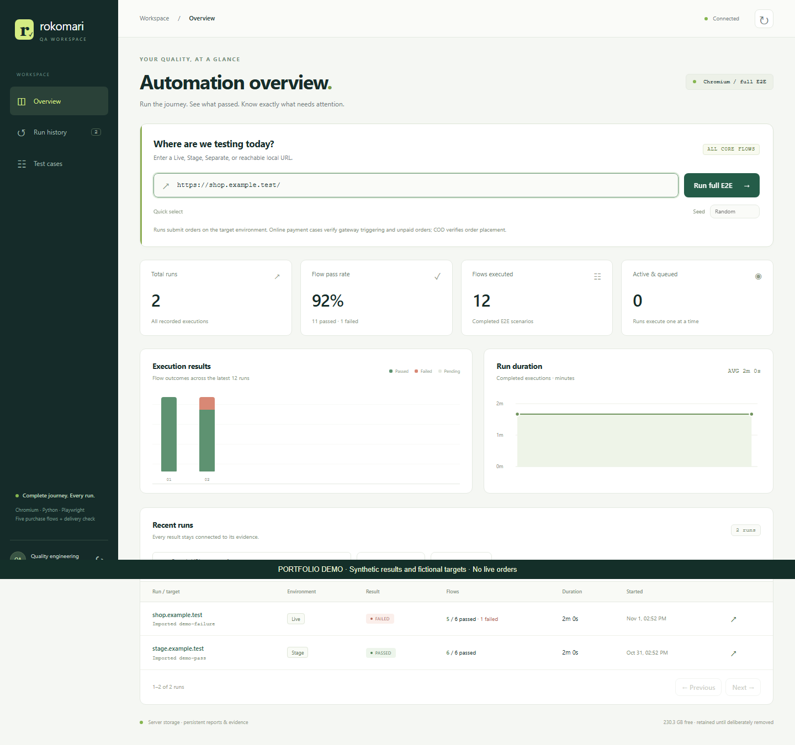
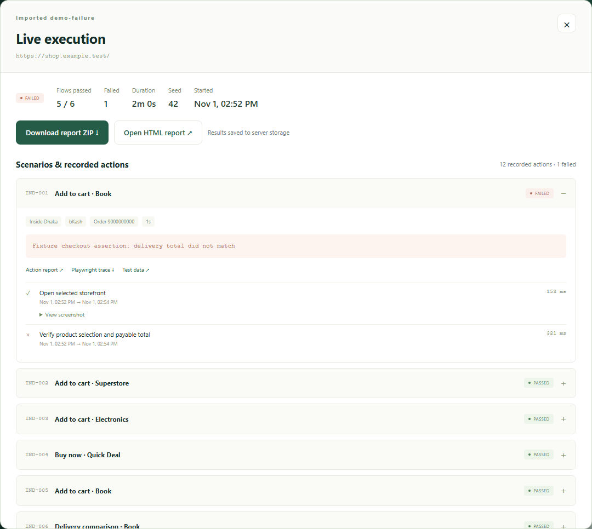
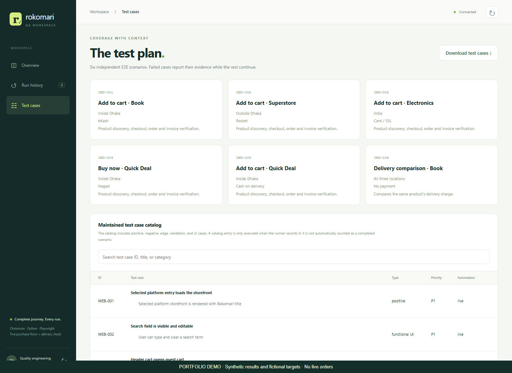
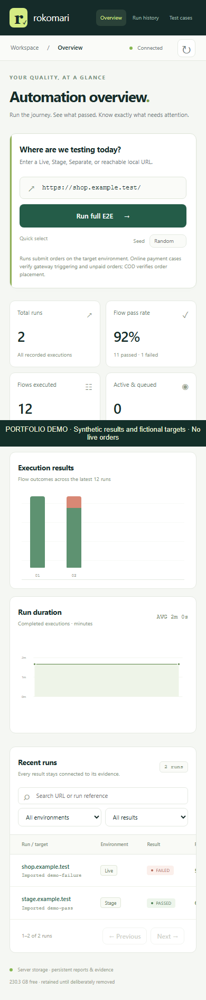
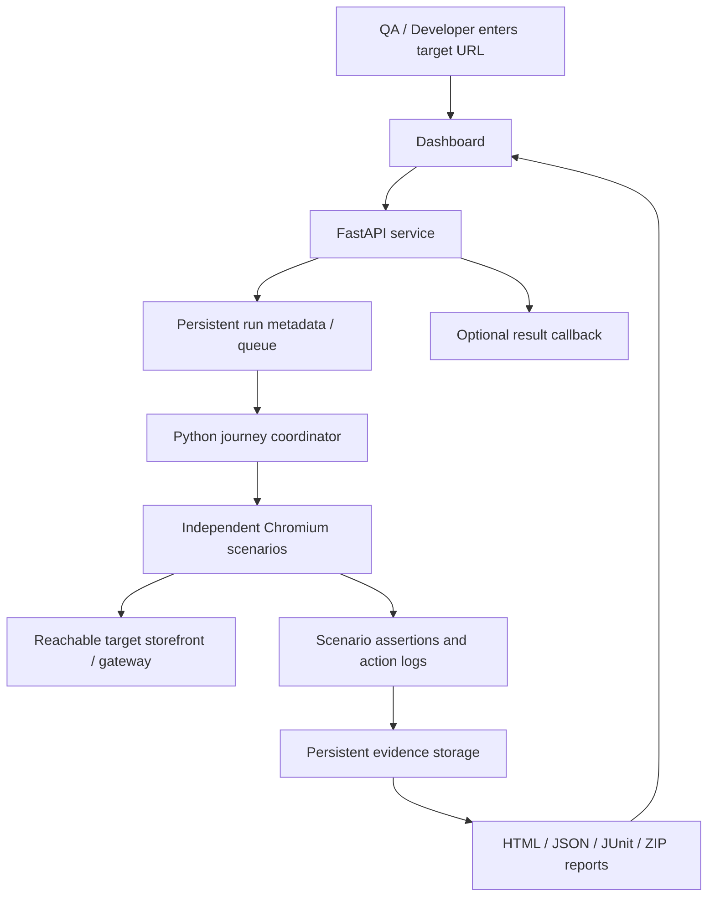

# Rokomari E-commerce E2E Automation Workspace

### From a target URL to independent checkout journeys and traceable results.

**A portfolio case study by Tanzid Hossain ? SQA / Test Automation**

Python ? Playwright ? Chromium ? FastAPI ? Docker ? SQLite ? HTML / CSS / JavaScript

> This public repository documents a private automation project. Application and
> test source code are intentionally excluded. Screenshots show the real dashboard
> populated with synthetic demo results and fictional URLs?not production pass rates.

## The problem

An e-commerce checkout can work for one product, address or payment method and
fail for another. A long dependent test can also stop at its first failure,
leaving the rest of the journey untested. Teams need a repeatable way to check a
new deployment, see which scenario failed and inspect the evidence without
requiring an automation engineer to operate every run.

## What I built

A Dockerized QA workspace where a team member enters a reachable storefront URL
and launches a defined full E2E plan. Python and Playwright drive Chromium;
the dashboard displays progress, scenario outcomes, action timings, graphs,
report downloads and previous runs. Execution requires no GPT session or AI API.

The project evolved from a single-product checkout script into independent
purchase scenarios with explicit product, region and payment coverage. Tests
and fixtures are maintained separately from the reporting and service layers.

## How a run works

1. **Choose the deployment.** Supply Live, Stage, a separate deployment or an
   exposed local URL reachable by the runner. Configured target access rules apply.
2. **Queue the run.** The service records the request and serializes execution to
   reduce shared-account/cart collisions.
3. **Run independent scenarios.** Each journey gets its own Chromium process and
   evidence. A failed scenario is reported while unrelated scenarios continue.
4. **Verify the journey.** Authenticate, discover an eligible product, use Add to
   Cart or Buy Now, select/create the regional address and check payment behavior.
5. **Verify the order.** Check expected order state, selected items and payable
   amount in the order list/tracking details, according to the scenario.
6. **Review the evidence.** Browse results, timestamps, screenshots, videos,
   available traces and captured test data; download the complete report bundle.

## Core execution plan

The maintained default plan uses explicit combinations so coverage is predictable.
Product discovery can vary eligible products using a recorded seed.

| Scenario | Entry flow | Product category | Delivery region | Payment / assertion |
| --- | --- | --- | --- | --- |
| IND-001 | Add to Cart | Book | Inside Dhaka | bKash trigger; unpaid order / To Pay checks |
| IND-002 | Add to Cart | Superstore | Outside Dhaka | Rocket trigger; unpaid order / To Pay checks |
| IND-003 | Add to Cart | Electronics | India | Card / SSL trigger; unpaid order checks |
| IND-004 | Buy Now | Quick Deal | Inside Dhaka | Nagad trigger; unpaid order / To Pay checks |
| IND-005 | Add to Cart | Seed-selected eligible category | Inside Dhaka | COD order placement and tracking verification |
| IND-006 | Delivery comparison | Same book | Dhaka, outside Dhaka, India | Compare fees without submitting an order |

**Payment boundary:** online-payment success in this suite means the gateway
was triggered and the expected unpaid-order behavior was verified. It does not
mean money was transferred or a real online payment was completed. COD is a
separate order-placement scenario.

**Coverage boundary:** e-books use a separate purchase flow; they are not claimed
as physical mixed-cart coverage. Product variants, preorder restrictions, stock,
country eligibility and gateway availability can affect what can be purchased.

## Engineering decisions

| Concern | Implemented approach |
| --- | --- |
| Product variety | Discover eligible candidates by category rather than always using one fixed SKU; record seed and chosen data |
| Existing cart contents | Deselect unintended items and verify the intended checkout selection and totals |
| Unexpected free gifts | A specific configured zero-price gift can be accepted; arbitrary extra charged items are not silently accepted |
| UI readiness | Locator assertions, navigation conditions and hydration checks rather than fixed sleeps in journey actions |
| Locator resilience | Defined fallback strategies and identity assertions; no runtime AI dependency or guarantee of adapting to arbitrary redesigns |
| Failure isolation | Independent scenario sessions and outcomes; later cases continue after earlier failures |
| Duplicate purchases | Persistent submission guards and explicit reconciliation; no blind purchase retries |
| Gateway navigation | Recovery paths handle supported return/back-navigation cases and verify the resulting order state |
| Regional checks | Generated test addresses around country/contact fixtures and relative delivery-charge expectations |
| Debugging | Per-action timestamps/duration, case data, screenshots, video and available Playwright traces |
| Deployment | Docker packages the website, API and Chromium runner; evidence uses persistent server storage |
| Automation triggers | Dashboard/API or CLI; automatic GitLab test pipeline removed at DevOps request |

Delivery assertions check the configured relationship between regional fees;
they are not a universal shipping tariff. Address fixtures and expectations must
match the target deployment's business rules.

## Dashboard and evidence

### Scenario drill-down

Expand a scenario to inspect its failure reason, action timeline and links to
case-level evidence. The example below deliberately includes a synthetic failure
so investigation is visible instead of showing only green results.

### Test plan and catalog

The workspace exposes the execution plan and the maintained test catalog.
Positive, negative, validation, UI and boundary cases have different automation
statuses. A catalog entry is not proof it executed in a particular E2E run;
the run report identifies the cases actually attempted and their outcomes.

### Responsive access

All screenshots were captured from an isolated local fixture. No real customer
accounts, delivery addresses, internal deployment hosts or live order evidence
are included. Numbers in these images are illustrative, not performance claims.

## Architecture

The backend uses SQLite for service metadata and the filesystem for evidence.
An external database is not required for this deployment. Docker's persistent
report volume preserves history across container recreation; retention depends
on server policy and available storage rather than a guaranteed lifetime.

## Reporting model

- **Run:** target, seed, timestamps, total duration and aggregate scenario status.
- **Scenario:** category, entry flow, region, payment method, outcome and order reference when available.
- **Action:** timestamp, elapsed time, assertion result and relevant evidence.
- **Investigation:** recorded test data, sanitized authentication diagnostics,
  screenshots/video and traces when available. Login tracing has different
  boundaries to limit credential exposure.
- **Distribution:** browser HTML report and downloadable ZIP; JUnit supports
  external tooling. Optional configurable callbacks can deliver completion status.

Timing data helps compare actions between runs. It is functional-test timing,
not a substitute for controlled load testing or a production performance SLA.

## Validation and practical limits

A recorded local regression verification completed **231 passing checks and 56
skipped checks**, with **8 focused browser/API checks passing inside Docker**.
These are implementation verification results from development, not a claim
that all live storefront journeys passed. Skipped checks are not counted as passes.

Live runs can fail because of incorrect server credentials, account state,
CAPTCHA/OTP, stock, shipping restrictions, changed UI or gateway availability.
For example, shared login failures were made actionable by adding authentication
stage, response-code and visible-error diagnostics. Another fix made browser
report downloads use the dashboard origin instead of a stale localhost URL.

## My contribution

- Defined the checkout coverage matrix and separated independent scenarios.
- Developed the Python/Playwright journeys, configuration and test-data structure.
- Added selected-cart checks, total verification and order tracking assertions.
- Built the QA dashboard/API, reporting, evidence collection and Docker packaging.
- Added repeatability controls, submission guards and deployment diagnostics.
- Worked with DevOps on GitLab review, persistent storage and deployment handoff.

## What this repository contains

| File | Purpose |
| --- | --- |
| `README.md` | Project case study, architecture, coverage and screenshots |
| `assets/` | Sanitized screenshots captured from the real UI using demo data |
| `WALKTHROUGH.md` | Suggested interview/demo walkthrough |
| `PUBLISHING.md` | Instructions for publishing this showcase without the private code |
| `NOTICE.md` | Source-availability, attribution and demo-data notice |

## Source availability

The implementation is private and is not included in this repository. This is
a portfolio showcase, not an installable distribution or an open-source release.
Rokomari is the product context; this portfolio does not imply company endorsement.
No software license is granted for the private implementation by this case study.
